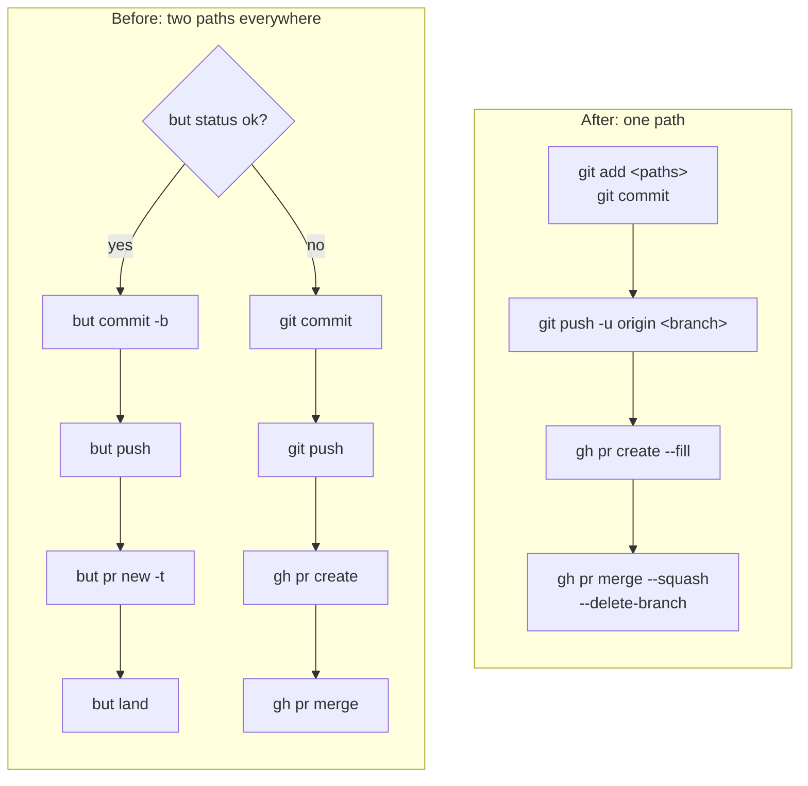
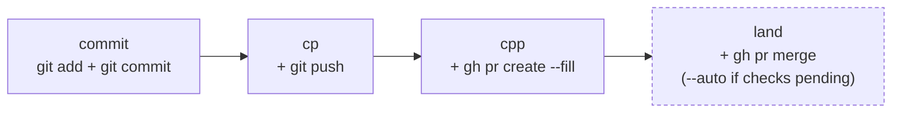
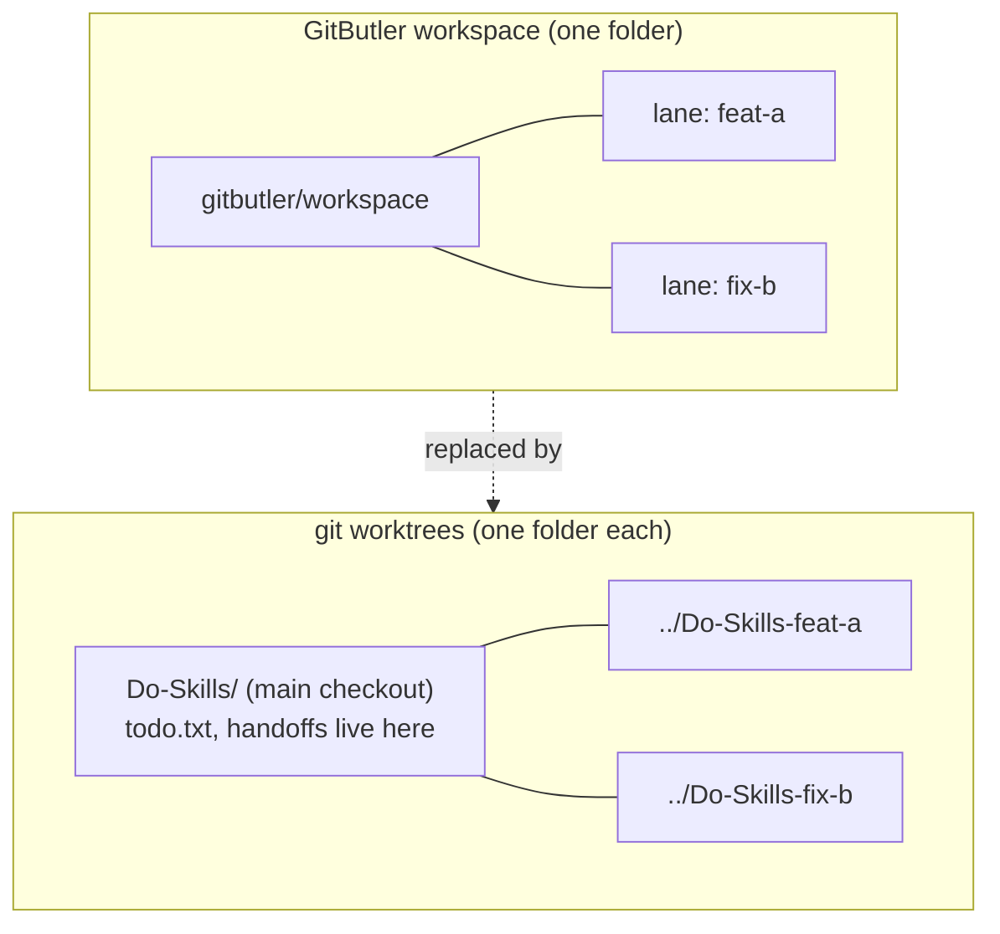
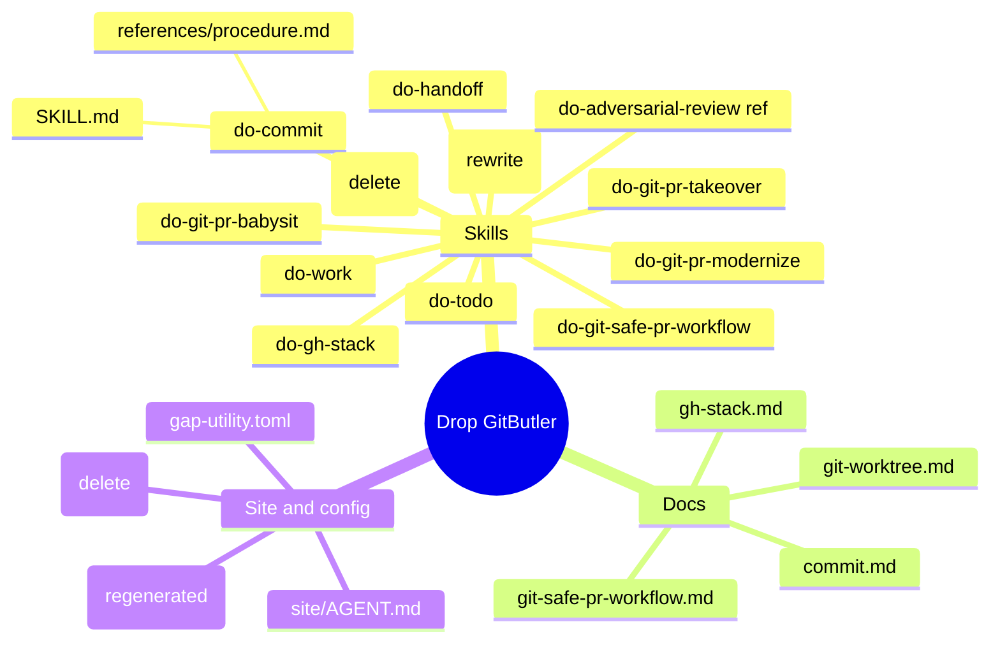
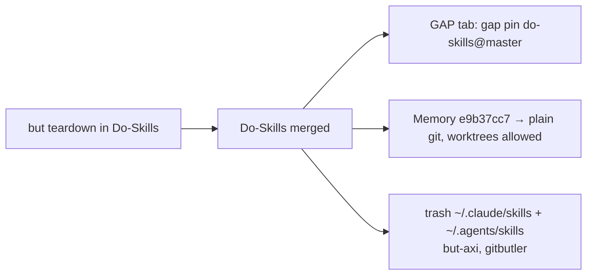

# Drop GitButler: back to plain git and git worktrees

Date: 2026-11-19 · Status: approved, in-repo edits done; `but teardown` pending · Owner: Do-Skills tab

GitButler (`but`, `but-axi`, `grit`) caused too many issues. Every skill goes back to plain `git` commits, `git push`, `gh pr`, and real `git worktree` folders, which every agent harness supports. `do-commit` keeps all four modes, including `cpp` (commit, push, PR) and `land` (merge), with the same behaviour minus `but`.

Aligned with the GAP policy change (`global/AGENTS.md:41`, uncommitted in the GAP tab).

## At a glance

| Count | What |
|---|---|
| 17 | files edited |
| 2 | files deleted (`do-grit` skill, `do-grit` site page) |
| 1 | generated README refreshed by script |
| 2 | dated docs left as historical record |
| 4 | changes outside this repo, only on your go |

## The model, before and after



## do-commit modes (kept exactly, minus `but`)



`land` still needs your explicit go. A caller passing `land` still returns `needs-human`.

## Parallel work: lanes become worktrees



Recipe (same as GAP): `git worktree add -b <branch> ../<repo>-<name>`.

## Command map

| Job | Before | After |
|---|---|---|
| Stage | `but` owns it, `git add -A` fallback | `git add <explicit paths>` |
| Commit | `but commit -b <branch>` | `git commit -m` |
| Push | `but push` | `git push -u origin <branch>` |
| Open PR | `but pr new -t` | `gh pr create --fill` |
| Merge | `but land --yes` | `gh pr merge <n> --squash --delete-branch` |
| Sync | `but pull` | `git fetch` + `git merge origin/<base>` (already in skill) |
| Conflicts | `but resolve` / `resolve finish` | `git rebase --continue` / merge conflict guide |
| Undo | `but undo` / oplog | `git revert` |
| Stack PRs | GitButler stacks or `gh stack` | `gh stack` only |
| No Mistakes gate | stay on workspace, `--branch`, `but branch update` | run on the checked-out branch, no `--branch` |
| Parallel work | lanes, worktrees banned | `git worktree add` |

## Files by area



## File-by-file edits

Legend: **DEL** remove lines · **REP** replace · **REW** rewrite file · **TRASH** delete file.

### 1. `skills/global/workflow/do-commit/references/procedure.md` (heaviest)

| Lines | Op | Change |
|---|---|---|
| 3-13 | DEL | Whole GitButler section, including the grit note |
| 19 | REP | "publishes with `but push` or `git push`" → "publishes with `git push`" |
| 22 | DEL | GitButler vs raw git ownership line |
| 24 | REP | "Do not `but push`, `but pr new`, `git push`…" → "Do not `git push` or `gh pr create`" |
| 25 | REP | → "Run from the checked-out feature branch. Do not run `axi sync` or `--recover`." |
| 26 | DEL | `--branch` flag note (GitButler only) |
| 27 | REP | → "When the run reports published commits, run the command it prints." |
| 35, 37 | REP | Drop "or `but diff` / `but commit` / `but status`" clauses |
| 38, 39 | DEL | "In a GitButler repo…" sentences |
| 52 | DEL | GitButler line |
| 95-108 | DEL | `but commit` block and "Otherwise:" label; git block becomes the only path |
| 112 | REP | `git add -A` → `git add <explicit paths>` (protects other tabs' work) |
| 130 | REP | Drop GitButler clause |
| 131 | DEL | GitButler line |
| 132 | REP | `git push` → `git push -u origin <feature-branch>` |
| 167 | REP | Drop "or `but status`" and the GitButler sentence |
| 174 | DEL | `but pr new` step; 175 `gh pr create --fill` is the only one |
| 179 + 181 | REP | Merge into one land step (below) |
| 183 | keep | Verify step |

```diff
- 1. GitButler: `but land <branch> --yes`.
- 2. Otherwise: `gh pr merge <number>`.
+ Land: `gh pr merge <number> --squash --delete-branch` (or the method the repo
+ allows). If checks are pending, add `--auto` and report it as pending.
```

### 2. `skills/global/workflow/do-commit/SKILL.md`

| Lines | Op | Change |
|---|---|---|
| 8 | REP | Drop ", grit (do-grit)" from NOT FOR |
| 37 | REP | "`but land` refused" → "`gh pr merge` refused (protected branch, missing approval)" |

### 3. `skills/global/workflow/do-gh-stack/SKILL.md`

| Lines | Op | Change |
|---|---|---|
| 7 | REP | Drop "or GitButler/but stacks" |
| 8 | REP | → "Uses `gh stack`." |
| 27-57 | DEL | Backend choice, whole "But stack" section, grit note |
| 58 | keep | "## gh stack" becomes the main body |

### 4. `skills/global/workflow/do-git-safe-pr-workflow/SKILL.md`

| Lines | Op | Change |
|---|---|---|
| 23-36 | DEL | Whole GitButler section |
| 43 | REP | Drop "stay on the workspace and pass `--branch`…" and "`but push`, `but pr new`" |
| 44 | DEL | GitButler line |
| 47 | DEL | `--branch` fork note |
| 48 | REP | → "run the command it prints" |
| 99 | REP | Drop "or `but pr new`" |
| 214 | REP | → "(not `git push` / `axi sync`)" |

### 5. `skills/global/workflow/do-git-worktree/SKILL.md` (REW, 38 lines)

| Before | After |
|---|---|
| Forbids `git worktree add` and `grit worktree` | Creates, lists, removes, prunes real worktrees |
| GitButler lanes via `but branch new`, `apply`, `unapply` | `git worktree add -b <branch> ../<repo>-<name>` |
| "Craft Agent" mention | removed |
| Asks before `but setup` | Asks before `git worktree remove --force` on a dirty tree |

New description: "Create, remove, list, and prune git worktrees as sibling folders (`../<repo>-<name>`)." Repo-level files (`todo.txt`, handoffs) stay in the main checkout.

### 6. `skills/global/workflow/do-git-pr-modernize/SKILL.md`

| Lines | Op | Change |
|---|---|---|
| 16 | REP | "`but pull`" → "`git fetch` the head remote and base"; "separate GitButler lane, never native worktrees" → "its own worktree (do-git-worktree)" |
| 26 | REP | → "rebase onto the fetched base with `git rebase`; resolve with `git rebase --continue`" |
| 28 | REP | "using `but` … If a direct Git push fallback is required…" → "through repository publication gates, with only…" (pinned `--force-with-lease` rule kept) |

### 7. `skills/global/workflow/do-git-pr-takeover/SKILL.md`

| Lines | Op | Change |
|---|---|---|
| 15 | REP | "isolated GitButler lane, never a native worktree" → "isolated worktree (do-git-worktree)" |

### 8. `skills/global/workflow/do-git-pr-babysit/SKILL.md`

| Lines | Op | Change |
|---|---|---|
| 22 | REP | "Use GitButler (`but`/but-axi)… never native worktrees" → "Use plain git for branch operations" |

### 9. `skills/global/workflow/do-work/SKILL.md`

| Lines | Op | Change |
|---|---|---|
| 23 | DEL | "GitButler owns branches." |
| 25 | REP | → "Git changes go through do-commit." |

### 10. `skills/global/core/do-adversarial-review/references/empryo-review.md`

| Lines | Op | Change |
|---|---|---|
| 12 | DEL | GitButler workspace bullet |
| 35 | DEL | "`verdict: null` also covers a GitButler lane…" (empty-report rule kept) |

### 11. `skills/global/personal/do-todo/SKILL.md` (from GAP tab)

| Lines | Op | Change |
|---|---|---|
| 24 | REP | Add: repo-level files live in the main checkout (the clone itself), never a linked worktree |

### 12. `skills/global/operations/do-handoff/SKILL.md` (from GAP tab)

| Lines | Op | Change |
|---|---|---|
| 17 | REP | Same main-checkout wording for `docs/plans/handoffs/` |

### 13. `skills/global/workflow/do-grit/` → TRASH

### 14-17. Docs (`docs/global/workflow/`)

| File | Lines | Op | Change |
|---|---|---|---|
| `commit.md` | 17 | REP | → "It commits with `git add` / `git commit`." |
| `commit.md` | 21 | REP | "`but push` or `git push`" → "`git push`" |
| `commit.md` | 29 | REP | → "`land` then runs `gh pr merge`" |
| `gh-stack.md` | 17 | REP | Drop GitButler backend clause |
| `gh-stack.md` | 29 | DEL | "GitButler path needs `but`." |
| `git-safe-pr-workflow.md` | 23-24 | DEL | GitButler sentence |
| `git-safe-pr-workflow.md` | 50 | REP | Drop ", and GitButler constraints" |
| `git-worktree.md` | 17-38 | REW | Describe restored worktree skill |

### 18-21. Site, config, READMEs

| File | Lines | Op | Change |
|---|---|---|---|
| `site/AGENT.md` | 63 | REP | "review with GitButler" → "review with `git diff`" |
| `site/src/pages/docs/do-grit.astro` | all | TRASH | Page removed (`/docs/do-grit/` 404s) |
| `gap-utility.toml` | 46 | DEL | `"do-grit",` |
| `skills/global/workflow/README.md` 37-38, root `README.md` | generated | script | `bash scripts/update-readme.sh`; workflow count 21 → 20 |

### Left untouched on purpose

- `docs/plans/research/2026-10-14-compound-engineering-workflow.md` and `docs/plans/2026-11-06-doskills-pages-cutover.md`: dated records.
- `do-delegation`, `do-debug`, design-system worktree mentions: already plain git.

## Outside this repo (only on your go)



- **GAP policy**: the GAP tab is already rewriting `global/AGENTS.md:41`; it pins this repo after merge.
- **Memory e9b37cc7** still says "GitButler, never native worktrees".
- **Installed skills** `but-axi` and `gitbutler` keep pulling agents back to GitButler.
- **`but teardown`**: this repo is still in GitButler mode; teardown must run before committing with plain git.

## Verify

1. Repo-wide search for `GitButler|gitbutler|but-axi|but (commit|push|pull|land|merge|setup|resolve|branch|apply|pr)|grit`: zero hits outside the two dated docs.
2. `node site/scripts/check-links.mjs`: no broken links besides the removed `do-grit` page.
3. Read each edited skill top to bottom: no dangling "Otherwise:", empty sections, or numbering gaps.

## todo.txt

- `+do-skills` Drop GitButler from all skills (this plan) `id:drop-gitbutler`
- `+do-skills` `but teardown` Do-Skills before plain-git commit `dep:drop-gitbutler`
- `+do-skills` Notify GAP tab to `gap pin do-skills@master` after merge `dep:drop-gitbutler`

## Decisions

:::question
Does "the What skills" mean `do-grit`?

grit is GitButler's Rust git client. The plan deletes the `do-grit` skill on that reading.

- [ ] Yes, delete `do-grit`
- [ ] No, I meant something else (note it)

Recommended: Yes, delete `do-grit`
:::

:::question
What happens to the `/docs/do-grit/` site page?

- [ ] Delete it (link 404s)
- [ ] Keep a short "removed" page

Recommended: Delete it (link 404s)
:::

:::question
Keep the two dated plan docs that mention GitButler unchanged?

They record past decisions; editing them rewrites history.

- [ ] Keep unchanged
- [ ] Scrub them too

Recommended: Keep unchanged
:::

:::question-multi
Which outside-repo steps should I also run?

- [ ] `but teardown` in Do-Skills
- [ ] Update memory e9b37cc7
- [ ] Trash installed `but-axi` and `gitbutler` skills
- [ ] Leave GAP policy to the GAP tab

Recommended: `but teardown` in Do-Skills, Update memory e9b37cc7, Trash installed `but-axi` and `gitbutler` skills and Leave GAP policy to the GAP tab
:::
