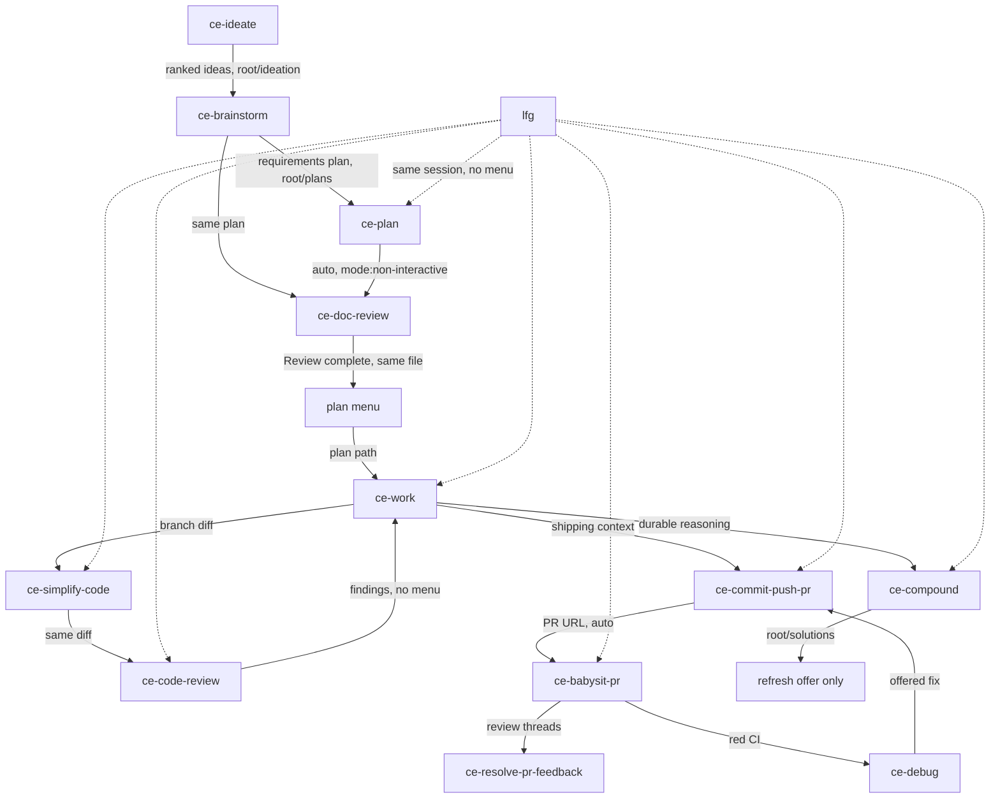

# Compound Engineering workflow absorption

Plugin `compound-engineering` 3.30.5 at `~/.omp/plugins/cache/plugins/compound-engineering-plugin___compound-engineering___3.30.5`. Counts are omp sessions that loaded or user-invoked the skill, 2026-08-17..2026-10-14 (339 sessions).

License: MIT, Copyright (c) 2025 Every (`LICENSE:1-12`). Copy and adapt are allowed if that notice stays with any substantial copied portion.

`<root>` is `docs_root` in `.compound-engineering/config.yaml`, else `docs` (`skills/ce-compound/SKILL.md:49-53`). Plans: `<root>/plans/YYYY-MM-DD-HHMM-<type>-<topic>-plan.<md|html>` (`skills/ce-brainstorm/SKILL.md:65`). Ideation: `<root>/ideation/`. Learnings: `<root>/solutions/`. Legacy `docs/brainstorms/` is input only (`skills/ce-brainstorm/references/brainstorm-sections.md:66-67`). Scratch: `/tmp/compound-engineering-$(id -u)/`.

## 1. Workflow graph

The slogan is brainstorm, plan, build, review, capture (`README.md:15`). `ce-brainstorm` writes WHAT, `ce-plan` writes HOW, `ce-work` executes (`skills/ce-plan/SKILL.md:11`). `lfg` is the only skill that runs the code path with no menu.



`lfg` (`skills/lfg/SKILL.md:7-59`) picks one work source. A code change then runs `ce-work mode:return-to-caller`, simplify (skip docs-only or under ~10 lines), `ce-code-review mode:agent`, fixes, optional `ce-compound`, `ce-test-browser mode:pipeline`, `ce-commit-push-pr mode:pipeline`, `ce-babysit-pr mode:pipeline`, then `<promise>DONE</promise>`. A bug skips work. No `git remote` means local commits only (`SKILL.md:45`). Merge stays with the user.

## 2. How each skill hands off

`CONCEPTS.md:170` calls this a handoff seam. Ask with the blocking question tool already listed, matched by capability, not host name (`skills/ce-brainstorm/references/handoff.md:49`). Caps: Claude Code 4, Codex 2-3. Over the cap, or no tool, or a real call errors: numbered list plus "Pick a number or describe what you want." Never skip. A pick loads the next skill here. No invocation primitive: print the command and stop (`handoff.md:136-138`). omp has `ask` and `/skill:<name>` (`docs/specs/omp.md:80-82`).

`mode:return-to-caller` and `mode:pipeline` delete the menu. The return ends this skill, not the turn; the caller is in this session and its next step follows the return (`handoff.md:17-19`, `skills/ce-plan/references/plan-handoff.md:58`, `skills/ce-debug/SKILL.md:83`).

| Skill | End of run | Skip / loop |
| --- | --- | --- |
| ce-ideate (1) | "Your ideation is saved to `<path>`. What next?" Open or Proof, brainstorm one idea, discuss, done (`skills/ce-ideate/references/post-ideation-workflow.md:88-96`). | Discuss stays. No jump to `ce-plan` in repo mode (`:122`). |
| ce-brainstorm (9) | "What would you like to do next?" (`handoff.md:73`). Plan (recommended), `lfg`, doc-review, prototype, open HTML, more questions (`:90-95`). Dismissed: `Recommended next step: ce-plan <plan artifact path>` (`:172`). | Plan and `lfg` hide while `Resolve Before Planning` is set. Doc-review re-renders the menu (`:117-122`). More questions returns to Phase 1.3 (`:142`). |
| ce-plan (17) | After auto doc review: "Plan ready at `<absolute path to plan>`. What would you like to do next?" (`skills/ce-plan/SKILL.md:60`). Start `ce-work` (recommended), review items, prototype, issue, open HTML (`plan-handoff.md:66-75`). | Start hides if not implementable. Review and prototype are exclusive. Edits loop (`:94`). Pipeline returns (`:58`). |
| ce-doc-review (10) | Last line `Review complete` (`skills/ce-doc-review/references/synthesis-and-presentation.md:269,325`). May name `ce-plan` or `ce-work` with no menu; invokes only if already authorized (`:327`). | Non-interactive skips routing (`references/modes.md:16`). |
| ce-work (17) | No ask. Simplify, review, `ce-commit-push-pr`, then "Suggest next steps if applicable" (`skills/ce-work/references/shipping-workflow.md:13-89`). | Mechanical diff skips both; simplify also skips under 30 lines (`:13,25`). Unoffered commits force `ce-commit` (`:67`). Return-to-caller stops after verify (`SKILL.md:58`). |
| ce-simplify-code (11) | Summary only (`SKILL.md:64-66`). | Caller owns the next rung. |
| ce-code-review (18) | "Do not offer push/PR/create-branch next steps from this skill." (`references/finish-review.md:196`). No blocking prompts (`SKILL.md:38`). | Caller applies. |
| ce-debug (16) | Before edits: fix, diagnosis only, or `ce-brainstorm` (`SKILL.md:64-68`). Then invokes `ce-commit-push-pr` or `ce-commit` without asking (`:116-117`). May offer `ce-compound` (`:122`). | Pipeline never asks (`:70`, `references/pipeline-mode.md:15`). |
| ce-commit-push-pr (27) | Auto-invokes babysit; "never ask yes/no" (`references/apply-and-handoff.md:39`). Not done until babysit owns the PR (`SKILL.md:67-69`). | Skip on `babysit:off`, draft, non-GitHub, or unpushable head (`:55-57`). |
| ce-babysit-pr (17) | No menu. Tick calls `ce-resolve-pr-feedback mode:pipeline` and `ce-debug mode:pipeline` (`SKILL.md:47-49`). Resume: `/ce-babysit-pr <url>` (`references/setup.md:25`). | Pipeline returns `needs-human` (`references/pipeline.md:5-7`). |
| ce-compound (2) | No "What's next?" menu (`references/report.md:9,90`). May print `/ce-compound-refresh <scope>` (`:5`). | Non-interactive never invokes refresh (`references/refresh-and-discoverability.md:30`). |
| ce-handoff (10) | Copyable `/ce-handoff resume <source>`, then stop (`SKILL.md:32-54`). | Continuity, not a rung. |
| ce-commit (26), ce-noslop (10), ce-explain (6), ce-worktree (6), ce-pov (7), ce-resolve-pr-feedback (3) | No lifecycle menu. Commit ends at `git status` (`skills/ce-commit/SKILL.md:60`). | Tools, not seams. |

No long-lived session: babysit checkpoint is one tick plus the resume command (`skills/ce-babysit-pr/references/setup.md:28`).

## 3. Wiring: markdown vs runtime

omp loads `.omp-plugin/marketplace.json` and root `skills/`. `.pi/extensions/compound-engineering.ts:8-11` only advertises that directory; the hook is a no-op on omp (`docs/specs/omp.md:19-26`). No `--to omp` converter. `src/` (45 files, 10,800 lines) is install-time translation, not a skill run (`README.md:415`). No hooks in `.claude-plugin/plugin.json`.

Portable: `SKILL.md`, `references/*.md`, persona prompts pasted into a generic subagent (`CONCEPTS.md:16-17`). Not portable: `skills/*/scripts/` (60 files, 49,532 lines) — `pr-snapshot`, `unit-workspace*.py`, cross-model shells — which need `git`, `gh`, and Python 3. `allowed-tools` (`skills/ce-resolve-pr-feedback/SKILL.md:5`) is Claude-only (`README.md:273`).

## 4. Git and worktree vs GitButler

`do-commit` is `disable-model-invocation: true` and uses GitButler, pushing only when asked (`skills/global/workflow/do-commit/SKILL.md:3-9`). `ce-commit` has no such flag (`skills/ce-commit/SKILL.md:2-3`), so "commit" shadows it.

| Assumption | Where | Conflict |
| --- | --- | --- |
| `git checkout -b` on default or detached HEAD, no ask | `skills/ce-commit/SKILL.md:34` | `but` owns the branch. A raw checkout misses the applied stack. |
| `git fetch` then `git checkout --no-overwrite-ignore -b`, or `git checkout -b` if fetch fails | `skills/ce-commit-push-pr/references/branch-creation.md:10,34,44`; detached: `references/context.md:33` | Same. Unpushed-commit question (`:24`) is a git-ref question, not a but question. |
| `git push -u origin HEAD` | `references/commit-and-push.md:23` | Not `but` push. Publishes the whole branch. CE warns (`skills/ce-debug/SKILL.md:113`, `skills/ce-work/references/shipping-workflow.md:67`) and still pushes. |
| `gh pr create --title ... --body-file` | `references/apply-and-handoff.md:75` | PR spans every branch commit (`skills/ce-debug/SKILL.md:113`). A but workspace often has unrelated applied work. |
| Feature branch from `origin/HEAD`; worktree only if the user asked | `skills/ce-work/references/workspace-setup.md:17-21` | Branch create still conflicts. Cross-model path ignores the ask. |
| `git worktree add --detach`; later `git worktree remove --force` | `skills/ce-work/scripts/unit_workspace_jobs.py:281`; `unit_workspace_lifecycle.py:955` | Native worktree on the external-model route. |
| Harness worktree, else `git worktree add -b ... .worktrees/<branch>` and `git worktree add` for a PR | `skills/ce-worktree/SKILL.md:37-50` | The skill's job. Drop it. omp `task` worktree isolation (`docs/specs/omp.md:83`) is the harness, not a reason to keep it. |
| `git checkout -b` on the default branch; pipeline pushes the fix | `skills/ce-debug/SKILL.md:78`; `references/pipeline-mode.md:14` | Auto-branch and auto-push, then `ce-commit-push-pr` (`SKILL.md:116`). |
| A `git remote` means `ce-commit-push-pr mode:pipeline`, then babysit | `skills/lfg/SKILL.md:45,55-57` | `lfg` creates no worktree. A remote counts as permission to publish. |
| Checkout must be the PR head branch; commit, push, reply, and resolve are pre-authorized | `skills/ce-babysit-pr/references/setup.md:21`; `references/envelope.md:38-42` | Needs a git checkout and push rights. GitHub only (`skills/ce-resolve-pr-feedback/SKILL.md:34`). |

Keep one escape: if project instructions name a shipping process, use it instead of `ce-commit-push-pr` (`skills/ce-work/references/shipping-workflow.md:69`). A port should make `/do-commit` that process.

## 5. Shared infrastructure

`skills/`: 442 files, 86,010 lines. Kernels: 36 `SKILL.md`, 2,273 lines. References: 317 files, 30,756 lines. Personas: 29 files, 2,114 lines (16 code-review, 8 doc-review, 3 simplify). Agent prompts: 38 files, 3,786 lines. Scripts: 60 files, 49,532 lines. `skills/CODING_STANDARDS.md`: 68 lines. No shared `references/` above skill folders.

Kernels Ed feels are small: `ce-commit` 60, `ce-worktree` 54, `ce-simplify-code` 101, `lfg` 626, `ce-commit-push-pr` 662. Bulk: `ce-work` 9,502, `ce-code-review` 8,664, `ce-plan` 8,357, `ce-brainstorm` 7,537, `ce-doc-review` 6,836, `ce-compound` 5,041. Port kernels and the seam. Leave the scripts.

## 6. Absorption plan

Port means a short skill with the outcome and the hand-off, not a file copy.

| Skill (uses) | Verdict | Target | Change |
| --- | --- | --- | --- |
| ce-commit-push-pr (27) | Drop | — | `do-commit` already ships via `but`. |
| ce-commit (26) | Drop | — | The shadow. Uninstall removes it. |
| ce-code-review (18) | Merge | `skills/global/core/do-adversarial-review` | Report-only; caller applies. Reuse `do-red-team`, `do-behavioral-testing`, `do-design-patterns-gof`. No persona copy. |
| ce-plan (17) | Port | `skills/global/workflow/do-plan` | Units and verification under `docs/plans/`. No elevation, HTML, or research farm. |
| ce-work (17) | Port | `skills/global/workflow/do-work` | Current checkout only. No branch, no worktree, no `unit-workspace.py`. End at `/do-commit`. |
| ce-babysit-pr (17) | Drop | — | Auto-push and "checkout is the PR branch" do not survive `but`. |
| ce-debug (16) | Port | `skills/global/workflow/do-debug` | Keep the three-way gate. No `git checkout -b`, no auto-push. |
| lfg (12) | Port | `skills/global/operations/do-lfg` | User-invoked. Plan, work, simplify, review, then print `/do-commit`. |
| ce-simplify-code (11) | Merge | `skills/global/core/do-simplify` | Reuse, quality, efficiency. Do not thin a safety check. Leave ponytail and pstack. |
| ce-noslop (10) | Merge | `skills/global/content/do-humanize` | Plain-prose tests if missing. No workflow edge. |
| ce-doc-review (10) | Port | `skills/global/workflow/do-doc-review` | One pass. End `Review complete`, then the template. |
| ce-handoff (10) | Port | `skills/global/operations/do-handoff` | Pointer-first note. Stop. No worktree. |
| ce-brainstorm (9) | Port | `skills/global/workflow/do-brainstorm` | Dialogue, requirements file in `docs/plans/`, then the template. |
| ce-pov (7) | Merge | `skills/global/core/do-red-team` | Judge a named candidate. Do not implement. |
| ce-worktree (6) | Drop | — | Native `git worktree add`. `do-git-worktree` is not a substitute. |
| ce-explain (6) | Merge | `skills/global/personal/do-teach-me` | How/why only. `do-show-me` stays visual. |
| ce-resolve-pr-feedback (3) | Merge | `skills/global/workflow/do-git-pr-review-triage` | Fix locally. User publishes with `/do-commit`. |
| ce-compound (2) | Merge | `skills/global/workflow/do-docs` | One `docs/solutions/` learning when the code does not carry it. |
| ce-test-browser (2), ce-prototype (1), ce-ideate (1) | Drop | — | Too little use for the machinery. |
| Unused 15: bakeoff, compound-refresh, dogfood, optimize, polish, product-pulse, promote, proof, retune, riffrec-feedback-analysis, setup, strategy, sweep, test-xcode, wtf | Drop | — | Zero sessions. |

Shared hand-off. End every loop skill with this. Do not invoke the next skill unless this request already authorized it.

```text
Next: <skill or /do-commit> — <one line why>, passing `<absolute artifact path>`.

Other moves:
1. <skill> — <when this is the better rung>
2. <skill> — <when this is the better rung>
3. Stop — the artifact is already saved.

Reply with a number, the label, or what you want instead.
```

If a blocking question tool is listed, ask with it and drop the last line. Otherwise print the block and wait. `mode:return-to-caller` returns `status` and the path instead. Publishing is never option 1 unless the user asked to ship. A finished change points at `/do-commit`, which the user runs, so `disable-model-invocation` holds and the shadow dies.

## todo.txt

- Uninstall compound-engineering after the ports land so ce-commit stops shadowing do-commit
- Add the shared Next: hand-off to do-brainstorm, do-plan, do-work, do-debug, do-doc-review, and do-lfg; publishing is /do-commit, never an auto git push
- Port do-brainstorm as a short requirements dialogue that writes docs/plans and stops at the hand-off
- Port do-plan as a short implementation plan in docs/plans, with no research-agent farm and no HTML renderer
- Port do-work to execute a named plan in the current checkout, with no git checkout -b and no git worktree
- Port do-debug with the fix / diagnosis-only / rethink gate and no auto-branch or auto-push
- Port do-lfg as user-invoked only: plan, work, simplify, review, then print /do-commit and stop
- Port do-doc-review to end on Review complete plus the hand-off, without persona scripts
- Port do-handoff as a pointer-first continuity note that does not start another skill
- Merge ce-simplify-code's three lenses into do-simplify; leave ponytail and pstack untouched
- Merge ce-code-review's report-only contract into do-adversarial-review; do not copy the persona directory
- Fold ce-noslop into do-humanize, ce-pov into do-red-team, ce-explain into do-teach-me, ce-resolve-pr-feedback into do-git-pr-review-triage, and ce-compound into do-docs
- Do not port ce-commit, ce-commit-push-pr, ce-worktree, ce-babysit-pr, or any zero-use skill
- Keep the MIT notice beside any substantial copied passage; otherwise rewrite
