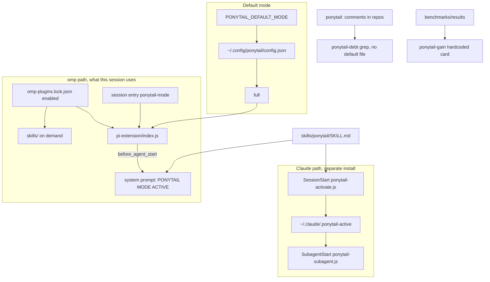

# Ponytail absorption research

Package: `@dietrichgebert/ponytail` 4.9.0 at `~/.omp/plugins/node_modules/@dietrichgebert/ponytail`, git `DietrichGebert/ponytail#2ed6c52` (`~/.omp/plugins/bun.lock`). Enabled in `~/.omp/plugins/omp-plugins.lock.json` (lines 13-16). Claude Code has a separate install, `ponytail@ponytail` 4.9.0 (`~/.claude/plugins/installed_plugins.json:84-92`). Removing the omp package does not remove that one.

## License

MIT, copyright 2026 DietrichGebert (`LICENSE:1-13`). Copy, modify, merge, and publish are allowed. Substantial copies must keep the copyright and permission notices. A short paraphrase of the ladder into GAP does not need the full license. A near-verbatim `SKILL.md` port does.

## How omp loads it

Two surfaces.

1. Skills. `omp-plugins` scans `skills/` under enabled npm plugins (`omp://skills.md` line 93, priority 90). That is why the six ponytail skills appear in the skill list. A skill load is on demand. The measured 44 sessions are loads or user invokes, not proof the injector fired in all 339. [INFERENCE: that 44 is the assignment's count, not re-measured here.]

2. Always-on mode. `package.json:39-41` declares `pi.extensions: ["./pi-extension/index.js"]`. omp loads `pi.extensions` from installed plugins (`omp://extension-loading.md` line 59). `before_agent_start` prepends `getPonytailInstructions(currentMode)` (`pi-extension/index.js:204-210`). The builder writes `PONYTAIL MODE ACTIVE — level: <mode>` plus the skill body with other intensity rows filtered out (`hooks/ponytail-instructions.js:11-41, 77-91`). This session's system prompt contains that block at `full`. That is the injector, not a skill the model chose to read.

omp does not run the Claude hook map. Native hooks must live in `hooks/pre|post/` (`omp://hooks.md`). Ponytail's hooks are `hooks/ponytail-*.js` plus `hooks/claude-codex-hooks.json`. omp slash discovery scans `commands/*.md` (`omp://slash-command-internals.md` line 86). This package ships `commands/*.toml`, so omp commands come from `pi.registerCommand` (`pi-extension/index.js:114-172`), not the toml. [INFERENCE: no runtime command dump.] No root `mcp.json`, so omp will not start `ponytail-mcp/`. [INFERENCE from absence plus `omp://plugin-manager-installer-plumbing.md` line 209.]

## Inventory

### Skills

Pure markdown. `.openclaw/skills/` is a generated copy (`README.md:325`).

| Skill | What it does | Where |
|---|---|---|
| `ponytail` | Lazy-senior ladder. Active every response until "stop ponytail" / "normal mode". Default `full`. | `skills/ponytail/SKILL.md:1-120` |
| `ponytail-review` | Diff-only over-engineering review. One line per finding. Does not apply fixes. | `skills/ponytail-review/SKILL.md:1-57` |
| `ponytail-audit` | Same tags, whole tree, ranked, plus a dep count. | `skills/ponytail-audit/SKILL.md:1-41` |
| `ponytail-debt` | Grep `ponytail:` comments. Writes `PONYTAIL-DEBT.md` only if asked. | `skills/ponytail-debt/SKILL.md:1-44` |
| `ponytail-gain` | Hardcoded benchmark card. Forbids per-repo savings. | `skills/ponytail-gain/SKILL.md:1-50` |
| `ponytail-help` | Levels, skills, config, update. | `skills/ponytail-help/SKILL.md:1-71` |

Ladder (`skills/ponytail/SKILL.md:32-64`): YAGNI, already here, stdlib, native, installed dependency, one line, then the minimum. Read the flow first. Grep callers and patch the shared function once. No unrequested abstraction. Mark a ceiling with `ponytail: <ceiling>, <upgrade path>`. Never cut validation, data-loss handling, security, accessibility, or an explicit request (`SKILL.md:90-95`). One assert demo or one small test (`SKILL.md:107-112`).

Intensity (`SKILL.md:77-88`): lite names the lazier alternative; full enforces the ladder (default); ultra deletes before it adds. `off` injects nothing. `review` is session-only, not a valid default (`hooks/ponytail-config.js:16-18, 76-81`). `AGENTS.md` is the 32-line copy for hosts that only read a root file (`docs/agent-portability.md:35-39`).

### Commands

`/ponytail [lite|full|ultra|off]`, `/ponytail-review`, `/ponytail-audit`, `/ponytail-debt`, `/ponytail-gain`, `/ponytail-help` (`README.md:305-312`). No argument reports the level. Same six names in `commands/*.toml` (Hermes, Gemini), `.opencode/command/*.md`, and `pi.registerCommand`. Review and the other four are aliases that send the skill name as a user message (`pi-extension/index.js:149-171`).

### Mode

Default resolution (`hooks/ponytail-config.js:76-99`): `PONYTAIL_DEFAULT_MODE`, then `~/.config/ponytail/config.json` `defaultMode` (`$XDG_CONFIG_HOME/ponytail` or `%APPDATA%\ponytail`), then `full`. This machine has no config file.

| Host | Store | Injector |
|---|---|---|
| omp / pi | Session entry `ponytail-mode`, newest wins (`pi-extension/index.js:24-36, 91-96`) | `before_agent_start` (`index.js:204-210`) |
| Claude / Copilot | `~/.claude/.ponytail-active` (or `CLAUDE_CONFIG_DIR` / `COPILOT_PLUGIN_DATA`). File contains `full`. | `SessionStart` → `ponytail-activate.js`; `UserPromptSubmit` → `ponytail-mode-tracker.js` (`hooks/claude-codex-hooks.json:2-38`) |
| Codex | `PLUGIN_DATA/.ponytail-active` (`hooks/ponytail-runtime.js:21-31`) | Same hook JSON, Codex-shaped stdout (`ponytail-runtime.js:58-66`) |
| OpenCode | `~/.config/opencode/.ponytail-active` (`ponytail.mjs:26-31`) | `experimental.chat.system.transform` (`ponytail.mjs:73-82`) |
| Hermes | Process-local `_current_mode` (`__init__.py:27, 125-128`; `README.md:213`) | `pre_llm_call` (`plugin.yaml:5-7`) |
| Qoder | `~/.qoder/.ponytail-active` | `UserPromptSubmit` does SessionStart's job (`ponytail-mode-tracker.js:91-93`) |
| Gemini | None | `gemini-extension.json:5` points at `AGENTS.md`. No levels. |

Deactivation is the whole message `stop ponytail` or `normal mode` (`hooks/ponytail-config.js:36-43`). `/ponytail default <mode>` writes config (`ponytail-mode-tracker.js:38-44`); session switches do not. Claude `SubagentStart` runs `hooks/ponytail-subagent.js` unless `PONYTAIL_SUBAGENT_MATCHER` excludes the type. omp does not run that hook; children still see the block because `before_agent_start` runs there. Statusline (`hooks/ponytail-statusline.sh:1-18`) is Claude-only.

Debt is a grep of `(#|//) ?ponytail:`, not a database. Output: `<file>:<line>, <what>. ceiling: <limit>. upgrade: <trigger>.` No trigger gets `no-trigger`. Writes `PONYTAIL-DEBT.md` only if asked (`ponytail-debt/SKILL.md:15-44`). Existing comments in Ed's repos were not searched.

Gain is not this repo. Card: 80-94% fewer lines, 47-77% less cost, 3-6x faster (`ponytail-gain/SKILL.md:16-45`; `benchmarks/README.md:36-62`). Agentic mean is ~54% less code (`README.md:27-29`). Data is `benchmarks/results/`.

MCP (`ponytail-mcp/index.js`) serves prompt `ponytail` and tool `ponytail_instructions`. Not always-on (`ponytail-mcp/README.md:7-11`). omp does not start it. Benchmarks, examples, tests, `scripts/uninstall.js`, assets, and `__init__.py` are package machinery (`README.md:290-301`). Drop them.

## Portable vs runtime

| Piece | Class | A SKILL.md can replace it? |
|---|---|---|
| Six skills, `AGENTS.md`, adapter rule copies, examples | Markdown | Yes. Examples and the gain card are not worth porting. |
| `commands/*.toml`, `.opencode/command/*.md` | Host manifests | No. omp commands come from the extension. |
| pi extension `before_agent_start` | Runtime | No. This is the omp always-on path. |
| Claude/Codex/Qoder hooks, statusline, flag files | Runtime | No. |
| Hermes `pre_llm_call` | Runtime | No. Process-local mode. |
| `config.json`, session `ponytail-mode` | State | No. A skill cannot persist lite/full/ultra. |
| Debt ledger | Grep over source comments | The scan is portable. New comments only appear if something still tells the agent to write `ponytail:`. |
| Gain card | Static markdown | Portable and useless per repo. |
| MCP | Runtime, user-invoked | No, and omp does not load it. |
| Benchmarks, tests, scripts, assets | Package maintenance | Drop. |

## Overlap and conflict

pstack stays. Both principles below are `disable-model-invocation: true`, so they do not fire unless asked. They are not an always-on substitute.

| Ponytail claim | DoSkills / pstack | Relation |
|---|---|---|
| Shortest diff, deletion over addition (`SKILL.md:60-61`) | pstack `do-principle-laziness-protocol/SKILL.md:11-16` | Duplicate. Do not restate it. |
| Ultra: deletion before addition (`SKILL.md:83`) | pstack `do-principle-subtract-before-you-add/SKILL.md:9-18` | Duplicate sequencing rule. |
| Grep callers, patch the shared function (`SKILL.md:50-54`) | pstack `do-principle-fix-root-causes/SKILL.md:14-18` | Adjacent. pstack adds reproduce-first and "state before code." Keep pstack for debugging. |
| One assert demo, no framework (`SKILL.md:107-112`) | `do-behavioral-testing/SKILL.md:17-22`; pstack `do-principle-test-behavior-not-implementation/SKILL.md:9-11` | Conflict. An `__main__` assert can pin an implementation. Do not copy this into `do-behavioral-testing`. |
| `net: -<N> lines possible` (`ponytail-review/SKILL.md:46`) | `do-simplify/SKILL.md:32, 67`: do not shorten code that gets harder to read; reject a cut whose benefit is line count | Conflict. Verified. Line count is the review skill's only score and the verdict `do-simplify` refuses. |
| Complexity only; route correctness elsewhere (`ponytail-review/SKILL.md:51-54`) | `do-adversarial-review/SKILL.md:13, 28`: correctness, not style; style goes to `simplify` | Complementary. Do not merge. |
| One implementation, delete the factory (`SKILL.md:36, 58`) | `do-design-patterns-gof/SKILL.md:159-161` | Already said. Point at GoF when the question is "which pattern." |
| Rung 1, skip speculative work | `do-first-principles/SKILL.md:12` | Different weight. A workflow versus one line. Do not merge. |
| Review / audit | `do-red-team/SKILL.md:12, 86` | No overlap. Red team attacks ideas, not code bloat. |
| Active every response (`SKILL.md:26-30`) | GAP `~/.omp/agent/APPEND_SYSTEM.md:25-26`: quality over a cheaper build; smallest change that works | Partial. Line 26 is one rung. Line 25 contradicts ultra and the line-count score. |

`do-simplify` fires after an edit (`do-simplify/SKILL.md:3`). Ponytail constrains the edit before it is written. Folding the ladder into `do-simplify` changes when it fires. Don't.

## Absorption

| Piece | Verdict | Target | Change |
|---|---|---|---|
| Ladder, read-first, don't cut validation/security/a11y | Short always-on rule. Not a new `do-*` that restates pstack. | GAP source that syncs to `~/.omp/agent/APPEND_SYSTEM.md` | Six to eight lines under Work. Do not override line 25. No intensity table. |
| lite / full / ultra / off, session entry, config.json | Drop with the plugin | none | GAP cannot switch per session. `full` is the only level the usage justifies. |
| `ponytail-review` tags | New skill. Not a merge into `do-simplify` or `do-adversarial-review`. | `skills/global/core/do-ponytail-review/SKILL.md` | Port `delete` / `stdlib` / `native` / `yagni`. Replace `shrink` and `net: -N lines` with "fewer concepts, not fewer lines" (`do-simplify/SKILL.md:63, 67`). One-shot. Does not apply fixes. |
| `ponytail-audit` | Same skill, scope line | same file | "Diff unless asked for the repo." |
| `ponytail-debt` | Section of that skill | same file | Keep the marker `ponytail:` so existing comments still match. Grep only. No default `PONYTAIL-DEBT.md`. |
| `ponytail-gain`, `ponytail-help` | Drop | none | Gain is a benchmark ad. Help is one line in the new skill's description. |
| Commands, hooks, pi extension, Hermes, OpenCode plugin, statusline, MCP | Drop with the omp plugin | none | Needs runtime. MCP is not loaded here. |
| Benchmarks, examples, tests, scripts, assets, adapter copies | Drop | none | Not user behavior. |
| Claude `ponytail@ponytail` | Separate decision | `~/.claude/plugins` | Same 4.9.0 tree. Leaving it keeps Claude always-on after the omp package is gone. |

Group: Global Core (`skills.sh.json:6-7`). Path: `skills/<scope>/<group>/do-<name>/SKILL.md`, at most three folders below `skills/` (`README.md:86-90`). If the review skill is a substantial copy, keep the MIT notice.

### Can he drop the plugin if those four absorb it?

No. `do-simplify`, `do-adversarial-review`, `do-red-team`, and `do-behavioral-testing` do not absorb Ponytail. They are a later clarity pass, a correctness hunt, an idea attack, and a test doctrine. None is injected. Two conflict with the parts people would paste in (line count, assert-demo tests). The 44 sessions are the ladder in the prompt.

He can uninstall the omp package after the short ladder is in GAP. He loses:

- Always-on injection, including omp subagents, unless GAP has the ladder.
- lite / ultra / off, and a level that survives the session without editing a file.
- `/ponytail-review`, `/ponytail-audit`, `/ponytail-debt` until the new skill exists. Prose still works.
- The instruction to write new `ponytail:` ceiling comments. Old comments stay greppable.
- The Claude statusline, and Claude's always-on, only if that plugin is removed too.
- Nothing from MCP, the gain card, or the benchmarks. omp never started the MCP server.

Always-on without the plugin belongs in GAP, not a skill. omp loads `~/.omp/agent/APPEND_SYSTEM.md` every turn (`APPEND_SYSTEM.md:13`); the same sync reaches Claude, Pi, Codex, and Cursor (`APPEND_SYSTEM.md:11-15`). Tradeoff: no per-session level, no off switch except editing the file, and those lines cost tokens on every synced harness, including non-coding turns. A "use on any coding task" description loaded ponytail 44 times and still is not injection. Six lines is the ceiling. Do not also paste them into `~/AGENTS.md` (`APPEND_SYSTEM.md:5`).

## todo.txt

- Add a six-line ladder to GAP Work, without overriding "quality over a cheaper build", then sync so omp `APPEND_SYSTEM.md` picks it up.
- Add `skills/global/core/do-ponytail-review/SKILL.md`: review tags, an audit scope line, and the `ponytail:` grep; score fewer concepts, not `net: -N lines`; include the MIT notice if the text is a substantial copy.
- Keep the `ponytail:` marker so existing ceiling comments still scan; do not invent `PONYTAIL-DEBT.md`.
- Point that skill at pstack laziness, subtract-before-you-add, and fix-root-causes instead of restating them.
- Leave `do-simplify`, `do-adversarial-review`, `do-red-team`, and `do-behavioral-testing` alone.
- After the GAP line is live, remove `@dietrichgebert/ponytail` from `~/.omp/plugins/package.json` and the lock entry; decide separately on Claude `ponytail@ponytail`.
- Do not port gain, help, MCP, benchmarks, examples, or adapter copies.
